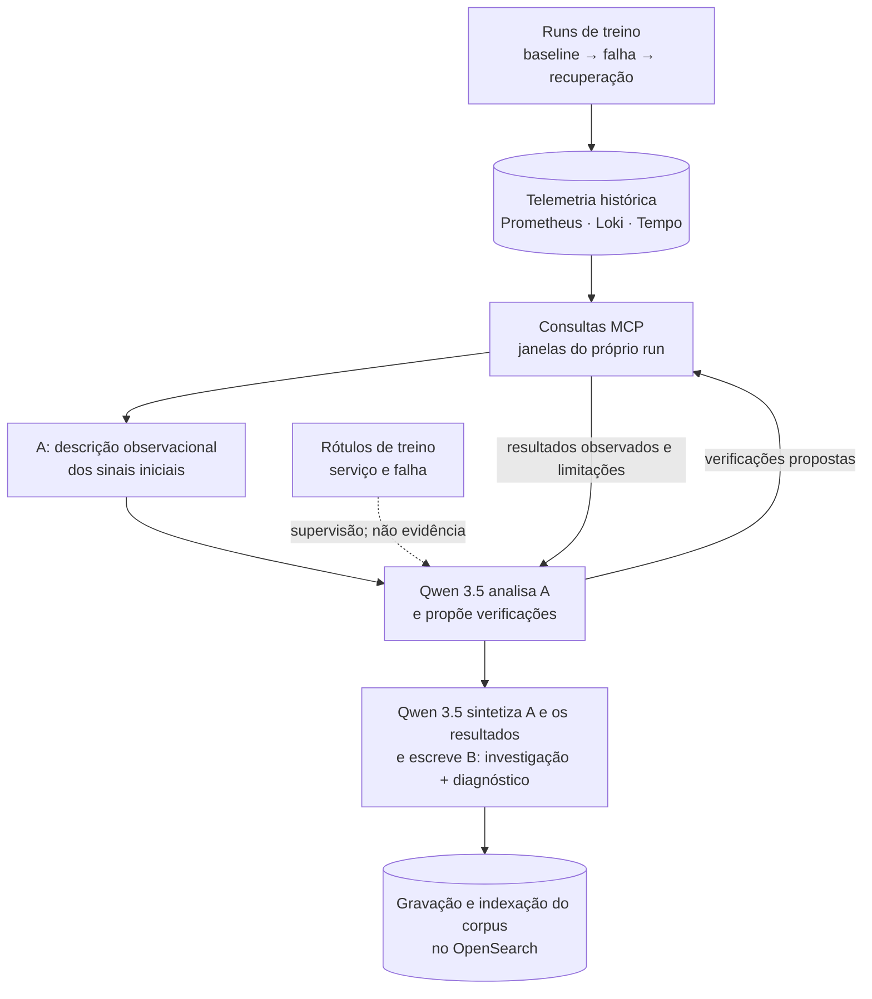
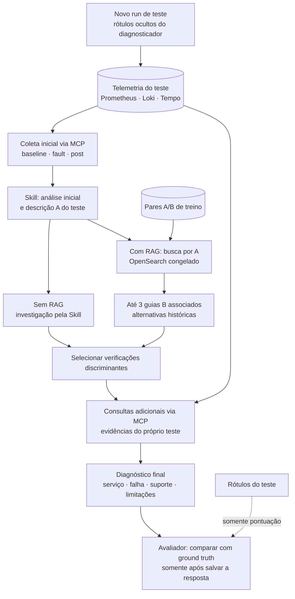

# Metodologia experimental — RCA com RAG

## 1. Objetivo e desenho

Investigar se procedimentos históricos melhoram o diagnóstico de falhas pelo Qwen 3.5 com uma Skill de análise de causa raiz (RCA). **Treinamento** designa a construção do corpus RAG, sem ajuste de pesos; **teste**, a avaliação em novas execuções.

| Elemento | Delimitação |
|---|---|
| Ambiente e matriz | Sock Shop: sete serviços × cinco falhas = 35 combinações |
| Falhas | CPU, memória, latência de rede, encerramento de container e códigos HTTP |
| Treino atual | Coorte-fonte de 32 pares A/B; quantidade aprovada depende da revisão |
| Teste planejado | 35 novas execuções das mesmas combinações |
| Unidade experimental | Um run: baseline → falha em um serviço → recuperação |

O teste avalia **cenários conhecidos**, não serviços ou falhas inéditos. Este documento descreve o método e o planejamento, não resultados.

## 2. Construção do conhecimento

**A:** descrição observacional sem rótulos da injeção. **B:** guia supervisionado que sintetiza os sintomas e as evidências consultadas em um caminho de investigação, sua interpretação e um diagnóstico.

Os runs de treino fornecem as janelas históricas consultadas via MCP; os sinais iniciais compõem A. A partir de A, o Qwen propõe verificações, recebe os resultados do MCP e pode solicitar novas consultas. Em seguida, sintetiza A e as evidências coletadas para escrever B. Os rótulos orientam a investigação, mas não são evidências. Por fim, o corpus é gravado e indexado no OpenSearch por uma etapa explícita.

## 3. Teste: integração entre RAG e MCP

O assistente produz A do teste com telemetria via MCP. A busca híbrida (vetorial + BM25, com fusão de rankings) seleciona **até três pares por A** e entrega os guias B associados: não são duas buscas independentes.

**MCP fornece evidências; RAG orienta verificações.** Os guias são alternativas, não gabaritos: se nenhum se ajustar, a investigação continua fora deles.

## 4. Comparação experimental

Comparação principal: **C0 — Skill sem RAG × C3 — Skill + RAG A/B**. Ablações propostas: **C1**, somente A; **C2**, somente B dos pares selecionados por A.

Manter casos, modelo, Skill, ferramentas e orçamento iguais. Na avaliação end-to-end, consultas adicionais podem variar; uma ablação apenas de síntese deve fixar evidências e checks e ser reportada separadamente.

## 5. Métricas e controles

| Dimensão | Medida e interpretação |
|---|---|
| Where | Acerto do serviço-alvo, não apenas de um serviço com sintomas |
| Why | Acerto do tipo de falha; não equivale a confirmação causal |
| Joint | Serviço e tipo de falha corretos no mesmo caso |
| Recuperação | Recall@3: proporção de casos em que ao menos um par correto está entre os três primeiros |
| Diagnóstico condicionado à recuperação | % de diagnósticos corretos entre os casos com recuperação correta |

Uma recuperação é considerada correta quando pelo menos um dos três pares recuperados corresponde ao serviço e ao tipo de falha do rótulo do caso. Essa correspondência é verificada pelo avaliador somente após salvar o diagnóstico, sem expor os rótulos ao modelo. Reportar também o número de casos no denominador; essa métrica condicionada complementa, e não substitui, o resultado Joint sobre todos os casos.
