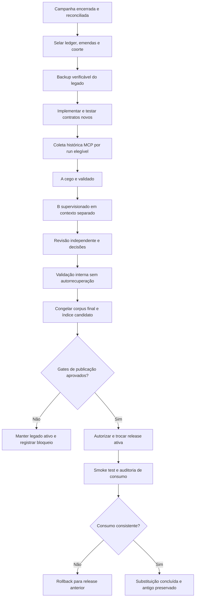

# Melhorias e plano de reconstrução/substituição da RAG no OpenSearch

**Data:** 04/11/2026. **Estado:** plano proposto, não executado.  
**Campanha de origem:** `controlled-20261103T234452388707Z`, train-only, 35 células.  
**Momento da inspeção operacional:** 10:44 UTC / 07:44 UTC-03 de 04/11/2026.  
**Autorização necessária:** acionar este plano depois do encerramento da campanha; a redação deste documento não autoriza iniciar coleta, inferência, indexação ou troca de configuração.

## 1. Objetivo, escopo e decisões

Reconstruir o conhecimento A/B usando os runs elegíveis da campanha atual, corrigir os problemas de representação e recuperação identificados e substituir **a versão ativa** da RAG por um corpus/índice novo, auditável e reversível.

Substituir não significa apagar o índice antigo. Ele deixa de ser o padrão para novas investigações, mas permanece preservado para auditoria e rollback. Runs e avaliações anteriores continuam vinculados à versão original.

Decisões deste plano:

1. Não alterar nem reinjetar a campanha em andamento. Não completar artificialmente 35 guias.
2. Construir a base nova somente com os runs elegíveis da campanha atual. Não mesclar silenciosamente os 32 pares legados.
3. Preservar separadamente validade da intervenção, qualidade da telemetria, suporte causal, revisão humana e utilidade para recuperação.
4. Gerar A observacional e cego; selá-lo antes de gerar B. B pode receber supervisão de treino, mas os rótulos ficam fora da projeção pública.
5. Manter Qwen 3.5 para geração, com artefato/hash/configuração fixados. Não atualizar pesos nem trocar para outro LLM generativo.
6. Manter inicialmente `top_k=3`, hashing de 256 dimensões e limite de dois checks posteriores ao histórico como controles de comparação. Embedding semântico, `top_k=5` e redistribuição do orçamento serão ablações posteriores, não correções já comprovadas.
7. Desenvolver suporte explícito a guias revisados no OpenSearch: o caminho atual só aceita históricos exploratórios pendentes. Não falsificar estados para contornar essa restrição.
8. Não afirmar melhoria de diagnóstico por ter publicado um índice melhor documentado. Aceite técnico e evidência científica são decisões diferentes.

## 2. Fontes, método e limites da reauditoria

### 2.1 Material efetivamente examinado

- Índice local `sockshop-rca-experiments-v1-8255d164bb4d41b8`: os 32 documentos completos, mapping e metadados; consultas somente leitura a `_search`, `_mapping` e `_analyze`.
- [Base legada original](../../experiment/platform/data/object_store/.rca_knowledge/exploratory-rag-20261028T191703038725Z/exploratory_base.json): 32 A/B completos.
- [Base derivada na migração de modelo](../../experiment/eval/memory_hog/out/exploratory_campaigns/exploratory-rag-20261028T191703038725Z/diagnostic_retries/qwen35-model-migration-v1/knowledge/model-retry-06bd4bc90b3a6f8265d9a858/exploratory_base.json): os mesmos 32 A/B.
- As 32 anotações originais `skill_knowledge_controlled-20261027T211124980806Z_annotate.json`, nos diretórios dos runs indicados no Apêndice A. Delas foram recuperadas evidências e reconstruídos os fatos de A.
- [Plano](../../experiment/eval/memory_hog/out/controlled_campaign/controlled-20261103T234452388707Z/plan.json), [configuração](../../experiment/eval/memory_hog/out/controlled_campaign/controlled-20261103T234452388707Z/config.yaml), [ledger](../../experiment/eval/memory_hog/out/controlled_campaign/controlled-20261103T234452388707Z/ledger.jsonl), [eventos](../../experiment/eval/memory_hog/out/controlled_campaign/controlled-20261103T234452388707Z/campaign_events.jsonl), [gates](../../experiment/eval/memory_hog/out/controlled_campaign/controlled-20261103T234452388707Z/effect_validation.json) e [read-backs](../../experiment/eval/memory_hog/out/controlled_campaign/controlled-20261103T234452388707Z/history_validation/) da campanha atual.
- Estrutura dos artefatos `observation_window.json`, `controlled_report.json` e `history_migration.json` dos cinco novos runs com gates aprovados até a inspeção.
- Código, contratos e testes identificados na seção 8; [plano anterior](./2026-11-03-evolucao-rag-treino-35-historico-online.md), [contrato de evidências](../../.github/skills/rca/references/evidence-contract.md), [checklist causal](../../.github/skills/rca/references/causal-checklist.md) e [protocolo de avaliação online](../../experiment/eval/memory_hog/CAMPAIGN_KNOWLEDGE.md).

Foi feita inspeção de conteúdo e de consistência dos artefatos, não uma nova avaliação de acurácia RCA. Não houve consulta aos datasources históricos para pontuar diagnósticos nesta auditoria. As evidências locais permitem auditar a construção anterior, mas não substituem a nova coleta MCP exigida para uma avaliação.

### 2.2 Identidade e reprodutibilidade

| Objeto | Identificação / resultado |
|---|---|
| Índice ativo auditado | Schema 1; `incident-a-v2`; `hashing-v1`; dimensão 256; 32 documentos |
| Hash de base declarado no índice | `8255d164bb4d41b80ef90e481bfad2d21da1943262823f5b9e8455bd0d2272f7` |
| Base original local | `74952d5bc64a82ca57621dd8ae39c3271313dc3811d6c24172ed173386b8bda4`; checksum válido |
| Base derivada local | `43d7221eaeb0058b776fd871cea0a3a0562d49ea4746545f461487f05518e9ba`; checksum válido |
| Identificadores | 32 `pair_id` únicos e 32 `source_run_id` únicos |
| Hash por documento | 32/32 reproduzidos, excluindo o próprio campo de checksum da entrada do hash |
| Vetor | 32/32 iguais ao embedding recalculado de seu `a_text`; dimensões, finitude e normalização coerentes |
| Reconstrução de A | 32/32 textos idênticos ao enriquecer A legado com as evidências originais; 640 fatos recuperados |
| Reconstrução da projeção | 32/32 `history` idênticos usando o A enriquecido e B da base local |

**Correção da interpretação anterior:** o arquivo congelado exato com hash `8255d164...` não foi localizado nos diretórios de bases examinados, mas o conteúdo indexado foi reconstruído integralmente. Isso reduz a incerteza de proveniência dos documentos; não elimina a necessidade de preservar a base exata e a receita de derivação no próximo release.

Os hashes de documento, par e base têm objetos de entrada diferentes; divergirem entre si não é sinal de corrupção. A base derivada de migração tem 32/32 A e B idênticos à original. O código de migração muda a identidade de modelo no envelope, não regenera os guias; essa migração não é evidência de reanotação com Qwen 3.5.

## 3. Estado da campanha e melhorias já presentes

No corte de 10:44 UTC, seis células estavam `completed`, das quais cinco com gates aprovados e uma excluída; a sétima (`orders-cpu-hog-r0`, `run-c1229d368fdb`) estava submetida. As demais 28 ainda não tinham submissão registrada. Esses números são um retrato, não o denominador final.

| Melhoria já presente | Limite que a reconstrução deve respeitar |
|---|---|
| Matriz train-only de 35 células, sem teste | É uma réplica por combinação; não demonstra generalização nem oferece um teste independente |
| Confirmação de intervenção/mecanismo, recuperação, cleanup e parada da carga | `completed` isoladamente não significa elegível |
| Read-back histórico de três famílias | Demonstra disponibilidade mínima, não cobertura causal suficiente |
| Continuação autorizada com exclusão de falhas técnicas | Não promover o caso excluído nem usar a continuação como aprovação |
| Overlay CPU de mínimo 80% da quota por 60 s para as células restantes | Emenda registrada, ainda candidata; estratificar protocolo original e emendado |
| Relatórios originais e emendas append-only | Preservar resultados originais e a origem de cada decisão |

`run-c877219ec395` (`payment/cpu-hog`) permanece excluído. A [rechecagem histórica](../../experiment/eval/memory_hog/out/controlled_campaign/controlled-20261103T234452388707Z/cpu-gate-historical-recheck-20261104T0850Z.json) não encontrou a série exata do contêiner; agregado por pod não a substitui. Não reinterpretar o resultado como sucesso ao final da campanha.

**Limite importante do read-back:** [history_stream.py](../../experiment/platform/backend/history_stream.py) usa `limit=20` para logs e `limit=1` para busca de traces na janela agregada. Pode recorrer a logs do namespace quando não há logs do contêiner. Nos seis read-backs concluídos inspecionados houve 20 logs do contêiner-alvo e um trace por run. Esses tetos configurados explicam as contagens; não são estimativas de completude, nem garantem sinal em fault ou detalhes dos spans.

O fluxo train-only não configura `knowledge_campaign` automaticamente. A/B e o novo índice não ficam prontos apenas porque a coleta termina.

## 4. Auditoria de A: conteúdo, indexação e perdas

### 4.1 Resultados quantitativos

| Medida | Base/fonte | Projeção enviada como histórico |
|---|---:|---:|
| Fatos métricos | 640: 20 por par | 128: quatro por par; 512 omitidos |
| Perfis métricos | CPU, memória, erro, P95 e request rate; 128 fatos de cada | CPU, erro, P95 e memória; nenhum `request_rate` |
| Observações narrativas | 381 | 188; perda real de 193 |
| Relações de serviço | 72 | 57 |
| Sintomas | 93 | 62 |
| Mudanças métricas narrativas | 63 | 52 |
| Padrões de logs | 58 | 11 |
| Padrões de traces | 46 | 4 |
| Sequência temporal | 49 | 2 |

A seleção atual retém o maior delta absoluto por nome de métrica e, depois, os quatro primeiros perfis. Nesta base, `request_rate` fica sistematicamente de fora. Isso não significa que request rate inexista no `a_text`: há 128 linhas desse perfil no índice.

A compactação considera no máximo duas observações por família e depois corta a lista em seis. O campo de omissão soma 122, mas a perda real é 193; **71 observações perdidas no primeiro corte não são contabilizadas**. O par `e50edbcd`, por exemplo, tem nove observações na fonte, duas na projeção e omissão registrada igual a zero.

As fontes completas têm duas ocorrências sem narrativa de logs, uma sem traces e uma sem sequência temporal. Isso é diferente das perdas causadas pela projeção. `history.limitations` vem de B; as limitações narrativas de A não têm campo próprio nessa projeção. `fact_limitations=[]` nos 32 casos cobre apenas o extrator de golden signals, não todas as famílias.

O analisador real do OpenSearch produziu de 483 a 858 tokens por `a_text`, com os dois valores centrais 643 e 646; 31/32 excederam 512. Isso mede tokens do analisador, não tokens do Qwen. O código atual de busca v1 envia `a_text` completo; o corte bounded-512 descrito no plano anterior pertence a outra execução. Não atribuir ao índice atual, sem observar a requisição, a perda lexical daquela execução. As projeções v2 por campos já existem no código, mas não no índice vivo v1.

### 4.2 Correções propostas para A

| Campo/superfície | Problema observado ou limite | Correção e critério |
|---|---|---|
| `observed_services` | Lista limitada a seis; não é inventário completo da aplicação | Derivar entidades observadas de fatos identificados, sem usar o alvo de injeção; separar catálogo conhecido de entidades observadas |
| `metric_facts` | Somente golden signals/top-delta; média não captura toda dinâmica | Preservar todos os fatos disponíveis; acrescentar perfis de lifecycle, quota/throttling e arestas quando a fonte permitir, sem inventar medidas |
| `metric_changes` | Mistura fato com inferência; há exclusões causais indevidas | Distinguir observação, hipótese e limitação; conferir identidade, estatística, valores e unidade contra o ponteiro |
| Unidade/delta | Texto usa `%` de forma ambígua | Distinguir pontos percentuais de variação relativa; não converter `s` em `ms` sem conversão registrada; não chamar média de P95 de P95 global |
| `service_relations` | Dependência presumida pode virar propagação causal | Registrar aresta chamador/destino/operação e se é observada ou só conhecida pela arquitetura |
| `log_patterns` | Log normal é usado para excluir falha; amostra pode ser truncada | Registrar contêiner/pod, fase, limite, linhas, filtro e cobertura; ausência não prova saúde |
| `trace_patterns` | `is_error`/duração viram HTTP 500/timeout; spans exclusivos viram CPU local | Código, flag, operação e semântica client/server devem ser explícitos; espera e processamento são hipóteses distintas |
| `temporal_sequence` | “Começou em” é deduzido de início de consulta ou simultaneidade | Preservar timestamp, origem e incerteza de scrape; quando a ordem não é identificável, escrever “coincidente/indeterminada” |
| `limitations` e cobertura | Limitações de A se perdem no histórico | Campo próprio por família/fase, com `ok/partial/no_data/unavailable/tool_error` distintos |
| Texto lexical e vetor | Campo único, repetições e números podem dominar | Campos balanceados, deduplicação, teste no `_analyze` e na consulta efetiva; budget por família sem corte cego de prefixo |
| Projeção para o modelo | Corte por ordem e por quatro métricas | Seleção determinística por família/perfil e pertinência observável, com contagem exata de perdas e limites explícitos |
| Referências | IDs históricos podem coincidir com os atuais | Namespace lógico `historical/<pair_id>/<evidence_id>`; preservar ID bruto no arquivo de origem |

Exemplos presentes no próprio índice: `a6fad188`, `d00e8c3a` e `179f0ac1` usam drops zero para excluir rede; `b7421965` estende isso a recursos/rede em geral. Drops de interface zerados não refutam atraso netem. Readiness normal também não prova ausência de restart.

Das 381 observações, 11 não referenciam nenhuma evidência com `fault_observation_count>0`. Algumas descrevem baseline/post ou ausência de dados e podem ser legítimas. O requisito novo não é apagá-las: é tipá-las por fase/finalidade e impedir que sustentem mecanismo de fault indevidamente.

## 5. Auditoria de B e correções propostas

### 5.1 Resultados e interpretação

- Os 32 B estão `pending/inconclusive`; 24 pares têm efeito validado e oito não, incluindo os sete CPU e `user/network-latency`.
- A classificação de B coincide com os rótulos em 32/32 pares supervisionados. Isso não mede acurácia cega nem valida causalidade.
- Existem 145 passos completos na base, dos quais 94 chegam ao histórico. Os 94 foram efetivamente cortados em 240 caracteres; perderam-se 51 passos inteiros. Duas relações sintoma também excedem o limite de 400 caracteres.
- Na fonte, os passos concatenam objetivo, verificação, suporte, refutação e aviso histórico. Cortar o final remove conteúdo discriminativo e pode remover o próprio aviso.
- Há referências textuais `E...` e `T...` sem resultado detalhado junto. O schema v1 não inclui `executed_checks`.
- A base exploratória usada para reconstruir o índice não preserva `evidence` nem `executed_checks` no par. Trocar só o mapping para v2 não recria resultados que esse par não contém.
- A base completa contém menções literais a rótulo/ground truth em 32/32 B, inclusive avisos de supervisão. Na projeção indexada são 13 itens, em sete pares: quatro relações, duas aplicabilidades e sete limitações.

Os sete pares são `8a92ce19`, `f5714a4b`, `81915392`, `682a39de`, `517496cb`, `42891685` e `b7421965`; todos têm efeito validado. Um filtro por efeito não os remove.

**Interpretação acadêmica:** rótulos de treino podem legitimamente supervisionar B. Menção a eles não demonstra vazamento do gabarito do teste. Aviso de procedência não equivale a uma afirmação causal contaminada. O problema é fazer a justificativa depender do rótulo, expor a atribuição sem declarar o desenho, ou misturar derivados de teste no treino. Revisão semântica e controle de linhagem são necessários; blacklist de palavras não basta.

### 5.2 B público contrastivo, não uma resposta a copiar

O B revisado deve manter, de forma estruturada:

1. **Sinais e contexto de aplicabilidade:** condições observáveis, não apenas uma lista heterogênea de categorias.
2. **Pelo menos duas hipóteses:** mecanismo, serviço/aresta, suporte, contraditórios e perguntas em aberto.
3. **Checks discriminativos:** instrumento disponível, consulta parametrizada, escopo, fase, suporte esperado, refutação esperada e resultado indeterminado.
4. **Resultado histórico real:** estado da consulta, contagens por fase, referências e digest. “Recomendado” e “executado” são estados distintos.
5. **Cadeia causal limitada pelo observado:** separar evento, mecanismo provável, sintoma e impacto; não afirmar timeout, GC, OOM ou código HTTP não medido.
6. **Contraindicações e lacunas:** ausência de log não refuta falha; CPU menor não exclui todos os mecanismos; restart não exige pico de CPU/memória.
7. **Revisão e origem:** hashes, versões, decisão e justificativa fora do texto usado para recuperar.

Separar artefato privado supervisionado de projeção pública. Campos `labels`, `target_result`, diagnóstico supervisionado e comentários “o rótulo diz” ficam privados. Classificação/atribuição histórica só poderá ser exposta em uma ablação rotulada, distinta do braço principal. A revisão não pode apenas substituir “rótulo” pelo nome da falha e preservar o raciocínio sem suporte.

Correções concretas de checks:

- Trocar comandos Kubernetes atuais e timestamps absolutos por consultas históricas parametrizadas com a janela do caso atual.
- Não usar `kubectl describe ... --previous`, nem `-p` como namespace. Não tratar wildcard de seletor como regex.
- Remover ações de remediação, como “criar regra de alerta”, do inventário diagnóstico somente leitura.
- Não prometer GC, perfil de threads, I/O ou atributos de memória por span sem fonte disponível. `iostat` não mede throttling de cgroups.
- Refutação exige evidência positiva incompatível com a hipótese ou cobertura suficiente; “não retornou dados” deve produzir resultado indeterminado.
- HTTP 406 não é evidência automática de timeout. `is_error=true` não identifica sozinho código 500, causa interna ou ponto gerador.

## 6. Alvo de dados e política de elegibilidade

O registro completo é imutável e fica fora do índice de serving, preservando A/B completos, evidências, respostas brutas, consultas e decisões. O índice contém A para recuperação, projeção histórica segura para o modelo e metadados de integridade/seleção.

| Dimensão | Estados/controle propostos | Uso |
|---|---|---|
| Execução experimental | Estado original, tentativa, gates e protocolo/emenda | Não alterar após publicação |
| Elegibilidade do run | `eligible` ou `excluded`, com razão | Somente `eligible` segue para o corpus principal |
| Disponibilidade de telemetria | Por família/fase/entidade, com cobertura e limitações | Read-back mínimo e qualidade diagnóstica são campos separados |
| Guia | `draft`, `reviewed_supported`, `reviewed_inconclusive`, `rejected` | Estados novos propostos, exigem suporte de código |
| Proveniência da geração | Modelo real de cada geração, prompts, Skill, parâmetros, tentativas | Nunca inferir autoria apenas de um envelope migrado |
| Evidência | Família, fase, identidade, unidade, ponteiro e hash | Checagem factual e causal |
| Publicação | Manifesto da release e conjunto exato de pares | Troca e rollback sem misturar versões |

**Corpus principal:** run elegível + claims verificadas + revisão aprovada + guia sustentado por pelo menos duas famílias independentes em fault, mesma ocorrência e identidade consistente. O gate experimental usa informação do controlador apenas para elegibilidade; essa informação não entra como suporte do modelo.

**Arquivo exploratório:** guias inconclusivos de runs elegíveis podem ser úteis como heurísticas, mas ficam fora da busca padrão e de alegações de causalidade validada. Uma ablação pode usá-los com estado e aviso próprios. Runs com gates reprovados ficam em arquivo de exclusões, não em suporte principal nem numa opção que os reintroduza por conveniência.

Não há número mínimo arbitrário de 35 guias. Se nenhum for elegível/revisado, não publicar base vazia nem reativar silenciosamente o legado como se fosse a reconstrução. Se houver cobertura parcial, informar quantas das 35 combinações estão ausentes; aceitar a release operacional só com limitação explícita, sem declarar cobertura completa.

## 7. Plano de execução após o término



### P0 — Confirmar encerramento, não apenas ausência do processo

- Exigir que as 35 células tenham resultado reconciliado, sem `submitted/running`, processo supervisor ativo ou escritor pendente. Um processo que morreu não caracteriza conclusão.
- Conferir `train_only_progress.json`, `collection_complete=true`, `approved_through_cell_count=35`, ledger e evento de conclusão. Esse arquivo é gerado pelo supervisor; não criá-lo manualmente.
- `all_gates_passed=false` pode coexistir com coleta concluída com exclusões; verificar cada exclusão, não relaxar o gate.
- Se a campanha parar antes de completar a coorte, este plano fica bloqueado até decisão explícita sobre a coorte incompleta. Não executar automaticamente a campanha para “terminá-la”.
- Conferir recuperação, limpeza e carga parada. Não reiniciar workloads nem reparar infraestrutura automaticamente.

**Entrega:** manifesto de encerramento, todos os denominadores e motivo de cada exclusão.

### P1 — Selar coorte, protocolo e legado

- Copiar para arquivo imutável: configuração original, plano, ledger, eventos, emendas, gates, janelas, manifests históricos e versão de software. Preservar hash da política CPU original e do overlay; não sobrescrever a configuração arquivada.
- Montar tabela de todas as tentativas e decisão por célula. Não selecionar a melhor tentativa por diagnóstico ou concordância com o rótulo.
- Fixar commits e hash do diff relevante, pois o checkout auditado tem modificações locais. Não fazer commit automático de alterações de terceiros.
- Exportar `_source`, mapping, settings e aliases do índice antigo; preservar bases e projeções reconstruídas. Guardar hashes e testar a reconstrução em índice isolado, sem afetar serving.
- Reconstruir e documentar a receita legada se o arquivo `8255d164...` continuar indisponível. Não atribuir esse hash a um payload diferente.
- Registrar todos os consumidores que usam corpus/hash/index/version e as configurações necessárias para restaurá-los.

**Gate:** backup legível, contagens e hashes verificados; restauração testada. Sem isso não há substituição.

### P2 — Pré-registrar e implementar correções

- Fixar schemas novos para A, B público/privado, projeção e índice; `v3` é a versão proposta para o novo contrato OpenSearch, ainda não existente.
- Reutilizar os mecanismos atuais de evidência, validação, `KnowledgeStore`, locking e publicação imutável. Não criar um pipeline paralelo que ignore essas garantias.
- Implementar batch pós-campanha train-only separado do supervisor. Aceitar manifestos de elegibilidade selados, sem exigir o plano antigo de 70 células nem uma anotação inline prévia.
- Não modificar as specs dos runs originais para encaixá-las em um novo `corpus_id`. O endpoint atual exige split/corpus fixados na spec; usar um caminho batch auditado, ou endpoint de reconstrução explicitamente versionado, sem burlar essa checagem.
- Versionar a política lexical, projeção, elegibilidade e limites; registrar a versão do OpenSearch/analisador e testar consultas extensas no servidor real.
- Fixar antes das análises parâmetros, qrels, condições, critérios e orçamento. Mudanças posteriores viram emenda e nova rodada, não escolha retrospectiva da melhor variante.

**Gate:** testes da seção 10 passam; nenhum novo contrato depende de marcar um guia revisado como `pending`.

### P3 — Coleta histórica para anotação

- Após encerrar a carga experimental, consultar novamente os datasources históricos via MCP, somente leitura, nas janelas reais baseline/fault/post.
- Selar um bundle de anotação por run com `annotation_id`, fontes, timestamps, queries, respostas sanitizadas, tool versions, limites e hashes. Não confundir snapshot operacional com evidência nova.
- Medir cobertura por fase e entidade; aprofundar logs/traces comparáveis onde necessário. Read-back de um trace e 20 logs não substitui essa coleta.
- Quando disponível, validar bundle de spans original por SHA, paridade de traces/spans, cobertura, coleta completa e erros. Arquivo e Tempo dos mesmos spans não são famílias independentes.
- Erros de backend bloqueiam a etapa; `no_data` legítimo vira limitação. Sem fallback silencioso para outra execução.
- Retomar a mesma anotação pode usar seu bundle selado. Uma avaliação posterior terá coleta nova e outro identificador.

**Entrega:** bundles auditáveis; matriz de cobertura; anotação bloqueada para fontes inválidas.

### P4 — Gerar e validar A

- A usa somente telemetria sanitizada, topologia observacional e janelas. Excluir rótulos, nomes de célula, nomes de arquivo com falha/alvo, relatório do controlador, B e diagnósticos prévios do prompt.
- Extrair números de forma determinística; a prosa do Qwen deve apontar para fatos existentes. Revisar associação serviço/contêiner/aresta, fase, unidade e código HTTP.
- Preservar sinais disponíveis de todas as famílias e as lacunas. Não preencher zero onde há ausência.
- Selar A completo e suas projeções com hashes distintos; registrar qualquer rejeição/reparo. Política proposta: no máximo uma correção estrutural por etapa; falha terminal não ganha tentativas ilimitadas.

**Gate:** 100% das referências e fatos publicados rastreáveis; zero contradição factual crítica não resolvida; nenhum rótulo inserido no contexto cego.

### P5 — Gerar B, revisar e qualificar

- Contexto novo e independente de A; recebe A selado, evidências e rótulos privados de treino. Registrar exposição à supervisão.
- Gerar checks a partir do inventário MCP realmente executável; guardar suporte/refutação/indeterminação e o resultado real. Manter ao menos duas hipóteses; não forçar correspondência com a etiqueta quando a evidência discordar.
- Projetar B público estruturado, sem cortes no meio dos campos críticos e sem transpor evidência histórica para a atual.
- Dois revisores independentes avaliam todos os guias candidatos, inicialmente sem rótulos de injeção: factualidade, identidade, temporalidade, alternativas, utilidade do check e causalidade. Depois confrontam elegibilidade/rótulos; divergências exigem adjudicação documentada.
- Reportar acordo bruto e kappa para decisões categóricas quando calculável, matriz de divergências e tamanho amostral. Uma revisão pelo próprio assistente gerador não equivale a revisão independente.
- Se só um revisor estiver disponível, registrar a limitação e obter decisão explícita antes da publicação; não simular dupla revisão.

**Gate:** todos os guias do corpus principal revisados e aprovados; nenhuma inconclusão promovida apenas por cumprir a matriz.

### P6 — Validação interna e seleção sem vazamento

- Aplicar o desenho da seção 9 antes da release final. Em cada fold, excluir do suporte o grupo avaliado e todos os derivados da mesma linhagem.
- Ajustar parâmetros apenas dentro dos dados de desenvolvimento autorizados. Não usar os 35 pares finais simultaneamente como suporte e teste.
- Versionar falhas de avaliação e decisões; não escolher a melhor execução do LLM.
- Congelar a variante selecionada. Se os dados não demonstrarem ganho, documentar o resultado nulo ou inconclusivo; qualidade de engenharia não é efeito causal de RAG.

**Entrega:** relatório de recuperação e diagnóstico internos, com incerteza e limitações; decisão explícita sobre publicação.

### P7 — Congelar e indexar candidato

- Criar novo `corpus_id`, manifesto completo, conjunto exato de pares elegíveis/revisados e vetores recalculados com o provider fixado. O corpus antigo não é sobrescrito.
- Preservar os bundles e A/B completos fora do índice. Indexar campos lexicais de A, vetor, projeção pública e metadados seguros.
- Verificar dimensões, finitude, normalização, hashes de base/par/projeção/documento e recomputar o embedding de cada texto.
- Criar índice físico novo. Não escrever no nome antigo nem reusar sua identidade para dados novos.
- Conferir os documentos armazenados, e não só a resposta do bulk. O teste de conexão deve validar conteúdo/checksums, não somente metadados e IDs.
- Testar exclusões, consulta sem vizinho relevante, ausência de histórico, orçamento e schema com o cliente real. Aumentar limite de cláusulas do servidor não substitui corrigir a consulta.

**Gate:** conjunto de IDs e hashes idêntico ao manifesto; nenhum rótulo privado na projeção; nenhuma falha de integridade, consulta ou elegibilidade.

### P8 — Substituir serving com rollback

O código atual deriva o nome físico do índice de `schema_version` e `base_sha256`. Portanto, **trocar um alias isoladamente não troca a RAG atual**.

1. Guardar a release anterior: corpus local, índice/hash/schema, versões A/B/projeção/retriever, provider, Skill e compatibilidades.
2. Preparar nova configuração desses componentes como uma única release. Atualizar API, batch/evaluators e demais consumidores identificados; invalidar caches por fingerprint, sem apagar artefatos antigos.
3. Publicar o ponteiro/configuração da release de forma atômica ou em janela sem novas requisições. Cada investigação resolve uma release no início e a mantém até o fim.
4. Se for introduzido alias, implementar antes sua resolução/validação no cliente. Não assumir suporte existente.
5. Manter `allow_legacy_skill_hash=false`, `allow_legacy_model_mismatch=false` e inclusão de runs inválidos desativada no caminho novo.
6. Fazer smoke test somente leitura: confirmar corpus, hashes, índice e pares efetivamente consumidos; validar projeções e isolamento de IDs.
7. Em qualquer mistura de versões, erro de leitura/hash, conteúdo privado ou elegibilidade indevida: parar novas investigações afetadas, restaurar a release anterior inteira e preservar os erros.
8. O rollback técnico não usa evidência congelada como fallback de uma avaliação. Avaliações abortadas ficam registradas e só são refeitas sob novo identificador.

**Critério de conclusão:** a versão nova está persistida e é realmente usada por todos os consumidores previstos, com smoke test aprovado e rollback reproduzível. A antiga está arquivada, não apagada.

## 8. Mapa de implementação por arquivo

As alterações abaixo são trabalho futuro. Não foram aplicadas durante a redação.

| Arquivo/superfície examinada | Estado atual relevante | Mudança necessária |
|---|---|---|
| [rca_knowledge.py](../../experiment/platform/backend/rca_knowledge.py) | A v2, fatos de golden signals, cortes de histórico, validação estrutural, freeze e modos diferentes | A/fatos/cobertura versionados; B estruturado; seleção balanceada; omissões exatas; referências históricas separadas; estados revisados e suporte de backend coerentes |
| [opensearch_experiments.py](../../experiment/eval/memory_hog/opensearch_experiments.py) | v1/v2; v2 já separa campos e pode incluir checks; indexação/conexão/busca exigem `pending/inconclusive` | Novo contrato para corpus principal revisado; filtros consistentes nos três caminhos; revalidação dos hashes do conteúdo; release/versionamento sem alterar legado |
| [api.py](../../experiment/platform/backend/api.py) | Conhecimento vinculado à spec; cache de resultado histórico e opções | Não reescrever specs; caminho de reconstrução autorizado; pinning de release e fingerprint que inclua versões/dados; avaliação nova não retorna resposta antiga como nova inferência |
| [controlled_campaign.py](../../experiment/eval/memory_hog/controlled_campaign.py) | Progressão train-only, exclusões, emenda CPU e exportação final | Reutilizar sua elegibilidade no batch; não mudar a coleta vigente; consumidor deve conferir progresso, ledger e emendas |
| [history_stream.py](../../experiment/platform/backend/history_stream.py) | Read-back mínimo, fallback de logs para namespace | Preservar semântica de disponibilidade; acrescentar relatório diagnóstico mais profundo na reconstrução, sem chamar read-back mínimo de completude |
| [rca_skill.py](../../experiment/platform/backend/rca_skill.py) | Contagem por família/fault e validação de diagnóstico | Compartilhar invariantes de evidência; testar suporte real dos claims, identidade, restart, erro e cobertura; não tratar IDs válidos como prova semântica |
| [evidence_projection.py](../../experiment/platform/backend/evidence_projection.py) | Projeção comum de evidências do modelo | Conferir preservação de fases/identidades/flags e budget da nova representação; reutilizar em vez de duplicar |
| [retroactive_b.py](../../experiment/eval/memory_hog/retroactive_b.py) | Requer plano antigo de 70 células e anotação prévia; possui passo estruturado útil | Reutilizar contrato de passo, não executar a CLI antiga contra train-only; adicionar caminho específico com manifesto selado e sem forçar rótulo como causa |
| [exploratory_rag_campaign.py](../../experiment/eval/memory_hog/exploratory_rag_campaign.py) | Concatena passos em texto, retém supervisão e seleciona consistência de rótulo | Não usar essa conversão como publicação principal; manter legado exploratório e construir projeção revisada sem esses atalhos |
| [retry_rag_diagnostics.py](../../experiment/eval/memory_hog/retry_rag_diagnostics.py) | Migração deriva envelope de base sem regenerar A/B | Manter autoria/proveniência por geração; não reapresentar migração de metadados como novo treino |
| [embeddings.py](../../experiment/platform/backend/analysis/embeddings.py) | Hashing e alternativa sentence-transformer já disponíveis | Congelar provider inicialmente; comparar encoder semântico só em ablação com reembedding integral e revisão/tokenização fixados |
| [campaign_knowledge.py](../../experiment/eval/memory_hog/campaign_knowledge.py) e [guia](../../experiment/eval/memory_hog/CAMPAIGN_KNOWLEDGE.md) | Avaliação online com `live_shared`; desenho próprio, sem ferramentas após pacote | Reusar coleta/selagem sem confundir com end-to-end; adaptar coorte/condições por protocolo novo e compatível |
| [frozen_rca_replay.py](../../experiment/eval/memory_hog/frozen_rca_replay.py) | Replay de evidência congelada desativado | Não reativar para pontuar este trabalho; usar somente rotinas puras úteis de integridade, se aplicáveis |
| [rag_campaign.py](../../experiment/eval/memory_hog/rag_campaign.py) | Opções, espera de arquivo e processamento ligado à campanha | Separar reconstrução pós-coleta de injeção; conferir defaults contra o protocolo congelado |
| [cpu-calibration.yaml](../../experiment/eval/memory_hog/cpu-calibration.yaml) e [plano vigente](./2026-11-03-evolucao-rag-treino-35-historico-online.md) | Overlay candidato e registro de emendas | Fontes de estratificação/eligibilidade; não editá-los para reaprovar histórico |
| Testes e documentação diretamente relacionados | Fixtures já cobrem vários contratos estruturais | Acrescentar regressões da seção 10 e documentar nova CLI/configuração somente depois de implementá-las |

## 9. Desenho de validação acadêmica

### 9.1 Hipóteses e fatores

| Hipótese | Comparação isolada | Evidência que a enfraquece |
|---|---|---|
| H1: seleção por prefixo elimina discriminadores úteis | Mesmos A/B e orçamento, projeção antiga vs. balanceada | Sem ganho de retenção útil/relevância após revisão |
| H2: B contrastivo melhora investigação | Mesma recuperação, B textual vs. B com checks/resultados | Checks continuam inválidos ou não discriminativos; ganho apenas de linguagem/confiança |
| H3: campos lexicais melhoram ranking | Mesmo corpus, vetor, k e projeção; campo único vs. campos balanceados | qrels não mostram ganho de relevância ou aumentam concentração inútil |
| H4: qualidade do corpus supera aumento de chamadas | Mesmo budget total C0/C1, corpus corrigido | Nenhum ganho pareado ou crescimento de falsa confirmação |

Não atribuir ao retrieval um efeito que também muda corpus, modelo, supervisão e budget. Uma comparação “legado vs. release inteira” é efeito do pacote, não identificação do componente responsável.

### 9.2 Coortes e ausência de vazamento

- Os 32 legados já inspecionados são desenvolvimento; não são teste intocado.
- Os até 35 novos são treino. Avaliar com o próprio par ou derivado no suporte é proibido.
- Desenvolvimento interno: sete folds agrupados por serviço, removendo do corpus todas as células/derivados do serviço avaliado, inclusive retries, revisões e paráfrases. Relatar transferência para serviço ausente, não generalização irrestrita.
- Geração, seleção de exemplos e tuning específicos de cada fold não podem consultar rótulos/evidências do grupo retido como suporte. Dados retidos só entram na investigação daquele caso.
- Se houver tuning, usar folds internos; folds externos não selecionam hiperparâmetros. O fato de os dados já terem sido inspecionados impede chamar isso de confirmação independente.
- Para isolamento do efeito de algoritmo/projeção, usar a mesma coorte e conjunto de suporte entre variantes. Comparação com legado de tamanho/origem diferente é secundária e explicitamente confundida.
- Nova coorte confirmatória requer autorização/protocolo separados; este plano não inicia injeções.

### 9.3 Condições e paridade de orçamento

| Condição | Pergunta |
|---|---|
| C0: mesma Skill/modelo/card, sem histórico | Referência sem RAG |
| C1: mesmos componentes, RAG corrigida | Efeito do histórico novo |
| Ablações de representação/recuperação | Efeito isolado de cada correção |
| Legado congelado | Comparação exploratória com o pacote anterior |

Na ablação de síntese, uma coleta online nova e selada pode ser compartilhada entre condições da **mesma avaliação**; não haverá ferramenta após B. Na comparação end-to-end, ambas as condições podem escolher checks sob o mesmo teto total MCP/LLM/tempo/tokens, incluindo reparos. Não comparar os dois desenhos como se fossem equivalentes.

Registrar chamadas antes/depois da recuperação, ferramentas, status, duração e valor discriminativo revisado. Manter inicialmente até dois checks pós-histórico; não aumentar o total para favorecer C1. Redistribuição de consultas iniciais para posteriores exige ablação pré-registrada, preservando a qualidade de A e a paridade do total. Medir a reserva final que impede checks; não removê-la sem substituir a proteção da síntese.

Cada `evaluation_id` faz nova coleta MCP histórica. Pode compartilhar essa coleta dentro da avaliação, nunca importar evidência de outra avaliação para pontuar. Falha de backend bloqueia a avaliação, sem fallback; a falha e o denominador planejado permanecem reportados.

### 9.4 Relevância, métricas e incerteza

- Qrels com rubrica: 0 = irrelevante/enganoso, 1 = contexto útil, 2 = check discriminativo transferível, 3 = forte correspondência observacional/mecanística. Dois avaliadores cegos ao ranking; adjudicação registrada.
- Anotar candidatos de forma suficientemente completa; com esta base pequena, preferir todos os pares elegíveis por query. Caso julgue só um pool, declarar incompletude; não converter não julgado em irrelevante silenciosamente.
- Para Recall/MRR, fixar relevante como nota >=2; reportar nDCG@3 com ganho `2^nota-1`. Queries sem suporte relevante são lacunas do corpus: relatar cobertura e métricas condicionais, não esconder nem imputar recall indefinido.
- Diagnóstico: serviço, `fault_type`, acerto conjunto, macro por tipo/serviço, matriz de confusão, inconclusões, confirmações sem suporte e falsas confirmações. Não substituir mecanismo por acerto do rótulo.
- Operação: contagens planejadas/submetidas/concluídas/excluídas/anotadas/aprovadas, consultas por etapa, rejeições, `no_data`, reparos, tokens medidos versus estimados, latência e custo de construção separados de inferência.
- Comparações pareadas por run; repetições do LLM não são novas unidades experimentais. Publicar ganhos/perdas e diferenças, não apenas percentuais independentes.
- Reportar intervalos de 95% de proporções e diferenças pareadas com método declarado. Teste exato de McNemar pode descrever discordâncias binárias; sua interpretação depende da independência dos casos. Com poucos serviços/grupos e dependências entre casos, destacar baixa potência e não usar p-valor isolado como prova.
- Se usar bootstrap agrupado por serviço, declarar que há só sete grupos e fazer análise de sensibilidade; não prometer precisão que o desenho não permite.
- Uma métrica primária pré-registrada por objetivo; demais métricas são secundárias. Não selecionar variante pelo melhor resultado entre múltiplas métricas, folds ou repetições.

**Critério científico:** aceitar um índice tecnicamente correto não exige inventar um ganho estatístico. Ganho alegado exige comparação pareada pré-especificada, estimativa de efeito, incerteza e controle de falsa confirmação. Se inconclusivo, publicar como infraestrutura/corpus revisado sem reivindicar superioridade diagnóstica.

## 10. Testes e gates de aceite

### Testes a acrescentar

1. Projeção com logs/traces/tempo disponíveis preserva conteúdo útil dessas famílias; quando omite, contabiliza tudo, inclusive perdas antes do corte global.
2. Todos os perfis métricos, inclusive request rate, têm representação ou omissão explícita; invariância à ordem de inserção dos campos.
3. Nenhum passo perde suporte/refutação por corte de caracteres; atingir budget gera seleção de unidades completas ou rejeição explícita, não texto mutilado.
4. Limitações A/B separadas; fases baseline/post e ausência não contam como suporte causal de fault.
5. Rótulos e comentários supervisionados privados não chegam ao prompt público; testes semânticos revisados além de regex.
6. `historical/.../E001` não é aceito como `E001` atual; referências `T...` recebem a mesma proteção.
7. Drops zero não excluem netem; restart/readiness não provam mecanismo; HTTP error não gera código/timeout fictício; memória/CPU não demonstram GC.
8. Queries com janela/pod antigos, comandos mutantes e instrumentos indisponíveis são rejeitados com erro auditável.
9. Run excluído por qualquer gate não entra no corpus principal; `completed` e `effect_validated` isolados não aprovam guia.
10. Guia revisado é aceito coerentemente por indexação, conexão e busca; legado permanece legível e imutável em seu modo original.
11. Hash adulterado, vetor incompatível, linhagem de teste e conteúdo privado bloqueiam publicação.
12. Consulta com campos reais e texto extenso não perde famílias nem provoca erro de cláusulas; score RRF não é tratado como probabilidade/confiança.
13. Troca/rollback preservam corpus/índice/provider/versões juntos; cache antigo não atende release ou avaliação nova.
14. `collection_complete` falso, run ainda ativo, progresso ausente ou exclusão sem justificativa bloqueiam a reconstrução.

### Suítes existentes a ampliar e executar na implementação

```bash
./.venv/bin/python -m pytest \
  experiment/platform/tests/test_rca_knowledge.py \
  experiment/eval/memory_hog/tests/test_opensearch_experiments.py \
  experiment/eval/memory_hog/tests/test_retroactive_b.py \
  experiment/eval/memory_hog/tests/test_exploratory_rag_campaign.py \
  experiment/eval/memory_hog/tests/test_campaign_knowledge.py \
  experiment/eval/memory_hog/tests/test_controlled_campaign.py -q
```

Executar primeiro seletores dos contratos alterados, depois esse conjunto relacionado e a integração com OpenSearch isolado. Fixtures/modelo falso validam software, não qualidade científica. Acrescentar testes da API e de outras superfícies efetivamente modificadas. Esta mudança documental não executou essas suítes.

### Checklist final de publicação

- [ ] Campanha encerrada e 35 células reconciliadas, sem escritores ativos.
- [ ] Coorte final selada; toda tentativa/exclusão e emenda preservada.
- [ ] Backup do legado verificado e restore/rollback ensaiados.
- [ ] Modelo real, Skill, prompts, parâmetros e software fixados.
- [ ] Evidência de anotação histórica selada; sem misturar com avaliação.
- [ ] A/B completos preservados; projeção e omissões auditáveis.
- [ ] Guias principais revisados; zero problema crítico pendente.
- [ ] Rótulos privados isolados; ausência de autorrecuperação por linhagem.
- [ ] Testes focados e integração aprovados; checksums e vetores 100% verificados.
- [ ] Avaliação interna relatada, inclusive resultados nulos e lacunas.
- [ ] Nova base não vazia, cobertura declarada e limites de uso aprovados.
- [ ] Release/corpus/índice/consumidores consistentes; cache segregado.
- [ ] Troca autorizada, smoke test aprovado e release anterior preservada.

## 11. Entregáveis e acionamento futuro

Na execução, produzir em diretório persistente de release, separado da campanha original:

- manifesto de coorte/linhagem e exclusões;
- export/restauração do legado com checksums;
- protocolo e emendas;
- bundles de anotação, A/B privados e projeções públicas;
- decisões independentes/adjudicação e relatório de cobertura;
- qrels, folds, resultados internos e tentativas completas;
- base congelada, manifesto de índice e testes;
- registro da troca, smoke test e procedimento de rollback.

Esses são **artefatos futuros**, não arquivos/CLIs já disponíveis. A CLI atual de `opensearch_experiments` cria v2 exploratório; executá-la isoladamente não cumpre este plano nem substitui automaticamente o serving. As CLIs antigas de anotação retroativa exigem 70 células e não podem ser usadas diretamente nesta campanha.

Próxima etapa operacional sugerida:

> Configure e valide os consumidores explicitamente com `corpus_id=rag-rebuild-v2-live-adjudicated-20261105` e base SHA-256 `b7ba43aea0e92c571803ca786513390c95d8d041a9b1af504755d2f968d913d3`. Antes de trocar qualquer configuração padrão, registre os consumidores atuais, teste rollback, mantenha a exclusão padrão dos sete casos sem efeito validado e não declare ganho diagnóstico sem avaliação pareada adequada. O índice legado permanece disponível.

## 12. Resultado da execução de 05/11/2026

**Conclusão:** a coorte foi adjudicada e um novo índice físico v2 foi criado e validado; o índice legado foi preservado. Não foi feita uma troca global de serving: não existe alias/pointer global, portanto consumidores precisam selecionar explicitamente o novo `corpus_id` e hash antes de usá-lo.

- A campanha original continua com `campaign_collection_complete=false`. Os 32 pares vêm da coorte selada; os gates originais permanecem **25 `effect_validated=true` e 7 `false`**. Não foram alterados rótulos experimentais nem promovidos os sete efeitos não validados.
- A revalidação MCP foi nova para este trabalho: 655/655 consultas, zero erros de transporte. Permanecem limites explícitos: 65/128 consultas Prometheus sem séries, 52/276 consultas Loki sem registros e 210 no limite de 150 entradas; OOM e perda de pacotes retornaram `no_data`. Três fases fault tinham apenas 3, 6 e 3 traces.
- Dois revisores cegos examinaram os mesmos 32 casos: 10 divergências; 7 aprovações mútuas e 25 casos revisados após adjudicação. Os seis diagnósticos antes marcados `confirmed` foram mantidos `inconclusive`. Em 22/32, previsões B divergiam dos rótulos experimentais antes da adjudicação; essas previsões não foram sobrescritas para coincidir com ground truth.
- Os A/B adjudicados estão preservados em [pares adjudicados](../../experiment/platform/data/object_store/.rca_knowledge/campaign-20261103T234452388707Z-rag-rebuild-v2-200k/review/adjudicated-pairs-live-mcp/). O [manifesto de adjudicação](../../experiment/platform/data/object_store/.rca_knowledge/campaign-20261103T234452388707Z-rag-rebuild-v2-200k/review/adjudication_manifest.json) fixa decisões, proveniência e hashes. O [manifesto de publicação](../../experiment/platform/data/object_store/.rca_knowledge/campaign-20261103T234452388707Z-rag-rebuild-v2-200k/review/opensearch_publication.json) registra os checks de OpenSearch.
- Base congelada: `rag-rebuild-v2-live-adjudicated-20261105`, SHA-256 `b7ba43aea0e92c571803ca786513390c95d8d041a9b1af504755d2f968d913d3`. Índice: `sockshop-rca-experiments-v2-b7ba43aea0e92c57`, OpenSearch 2.19.0, schema v2, 32 documentos, embedding `hashing-v1`/256 dimensões e texto A `incident-a-v2`.
- Smoke tests reais retornaram 25 pares no filtro padrão, todos validados; com inclusão exploratória explícita retornaram 32, incluindo os sete não validados. Autoexclusão do run-fonte e ausência de `labels`/`diagnosis` na projeção foram verificadas. Três pares tiveram resumos de checks históricos omitidos da projeção compacta por limite de 8.000 caracteres; os registros completos permanecem nos pares adjudicados.
- O smoke test com A extenso revelou `too_many_nested_clauses` no multi_match v2. A busca lexical foi alterada para consultas limitadas por família de campos (até 24 termos/família), preservando a busca densa com o texto integral; consulta real extensa passou. Os testes `test_rca_knowledge.py`, `test_opensearch_experiments.py` e `test_frozen_rca_replay.py` passaram.
- Índice legado `sockshop-rca-experiments-v1-8255d164bb4d41b8`: continua com 32 documentos e base SHA-256 `8255d164bb4d41b80ef90e481bfad2d21da1943262823f5b9e8455bd0d2272f7`. Nenhum alias foi criado para o candidato ou legado.

Esta publicação valida integridade, elegibilidade e recuperação; **não mede nem reivindica melhora de acurácia diagnóstica**. Execuções antigas e consumidores existentes não foram repontados automaticamente.

## Apêndice A — Inventário dos 32 pares legados

Esta tabela é auditoria de desenvolvimento e contém atribuições experimentais privadas; **não copiá-la para a projeção de serving**. `Efeito` é o estado armazenado, não aprovação causal. Todos os guias estão pendentes/inconclusivos. O identificador abreviado resolve o `pair_id` único nas bases; o link do run leva aos arquivos originais. `Obs.` = observações completas → fornecidas. `Passos` = completos → fornecidos; todos os fornecidos estão truncados. As correções abaixo são prioridades de revisão, não novos diagnósticos.

| Par / fonte do run | Atribuição; efeito | Obs.; passos | Leitura de A e melhoria específica para B |
|---|---|---|---|
| `6672f1d9` — [run-406af66d1b8a](../../experiment/platform/data/object_store/run-406af66d1b8a/) | orders/CPU; não | 8→6; 8→3 | A correlaciona CPU/latência; B transforma isso em causa e associa HTTP 406 a timeout. Excluir do principal; distinguir código observado de mecanismo e validar quota/throttling. |
| `05d67f09` — [run-59b20e3bf4b9](../../experiment/platform/data/object_store/run-59b20e3bf4b9/) | catalogue/HTTP; sim | 10→6; 4→3 | A registra logs normais e trace de erro; esses logs/traces desaparecem da projeção. Revisar origem do HTTP e trocar comandos `kubectl -p`, wildcard e timestamp fixo por checks históricos executáveis. |
| `9f26ad16` — [run-028a014de112](../../experiment/platform/data/object_store/run-028a014de112/) | carts/HTTP; sim | 16→6; 3→3 | A destaca orders e sinais compartilhados; B admite que traces não explicam o código específico. Preservar a fronteira cliente/servidor e não tomar 500 como demonstrado apenas por `is_error`. |
| `8a92ce19` — [run-03e42d5b64a8](../../experiment/platform/data/object_store/run-03e42d5b64a8/) | payment/kill; sim | 9→6; 4→3 | A traz impacto em orders/front-end e logs de carts-db. B ancora no rótulo e pressupõe pico de CPU/memória como indicador típico de kill. Buscar identidade/terminação/restart; remover `describe --previous` e inferência por etiqueta. |
| `c1ce2ef3` — [run-7b8972e3680b](../../experiment/platform/data/object_store/run-7b8972e3680b/) | front-end/CPU; não | 6→6; 7→3 | Projeção retém todas as observações, mas corta quatro passos. Separar CPU local de espera por orders; manter excluído do principal. |
| `019b2385` — [run-33da9c5c946a](../../experiment/platform/data/object_store/run-33da9c5c946a/) | catalogue/memória; sim | 18→6; 6→3 | A enfatiza CPU/latência e usa health check para excluir hipóteses. B afirma consequência direta da memória. Preservar memória, limites e alternativas; saúde pontual não refuta contenção. |
| `1a3bb012` — [run-ca48a84b1711](../../experiment/platform/data/object_store/run-ca48a84b1711/) | user/rede; não | 11→6; 6→3 | A atribui fluxo/ordem temporal a dependências; B reconhece ausência de tempo de rede vs. processamento. Excluir do principal e verificar arestas/client-server antes de transferir o guia. |
| `a6fad188` — [run-a82eb08aca76](../../experiment/platform/data/object_store/run-a82eb08aca76/) | shipping/rede; sim | 20→6; 4→3 | A usa drops zero para excluir rede física/CNI e latência exclusiva como processamento. B aponta rede/processamento. Retirar refutação inválida e recuperar logs, traces e temporalidade omitidos. |
| `f5714a4b` — [run-34f60500cbfd](../../experiment/platform/data/object_store/run-34f60500cbfd/) | user/kill; sim | 12→6; 3→3 | A mistura frases em inglês e referências sem sinal fault para certas observações. B admite ligação inferencial entre kill e parsing JSON. Padronizar narrativa, preservar limitação e investigar motivo/identidade do restart. |
| `064dadab` — [run-18b0056979cf](../../experiment/platform/data/object_store/run-18b0056979cf/) | carts/memória; sim | 9→6; 2→2 | A/B enfatizam CPU e impacto em orders; B atribui isso à memória. Distinguir pressão/GC de CPU e espera; GC só com instrumento disponível, não por suposição. |
| `547971a7` — [run-b2dceac554d2](../../experiment/platform/data/object_store/run-b2dceac554d2/) | payment/CPU; não | 19→6; 6→3 | A escreve aumentos de latência como `%` sem explicitar cálculo; B corretamente admite incerteza. Conferir unidades contra fatos e não preencher lacunas com teoria de threads; excluir do principal. |
| `caaf3370` — [run-12fe1295d6c2](../../experiment/platform/data/object_store/run-12fe1295d6c2/) | carts/CPU; não | 8→6; 3→3 | A não tem narrativa de logs; B sugere causa de CPU por correlação. Preservar lacuna, evitar causalidade forte e manter exclusão. |
| `4c359c9d` — [run-5a840238c09e](../../experiment/platform/data/object_store/run-5a840238c09e/) | user/HTTP; sim | 12→6; 3→3 | A explicita logs ausentes; B usa falta de spans downstream como indício da origem. Exigir código/flag e fronteira observada; ausência de span é também limitação de coleta. |
| `81915392` — [run-d44e66cf7697](../../experiment/platform/data/object_store/run-d44e66cf7697/) | shipping/kill; sim | 14→6; 3→3 | B diz “causa raiz do rótulo” e admite não observar a morte. Remover ancoragem, obter evento/UID/tempo e tratar ausência de eventos como indeterminação, não refutação automática. |
| `956fc4db` — [run-4b9446c9583a](../../experiment/platform/data/object_store/run-4b9446c9583a/) | payment/HTTP; sim | 10→6; 4→3 | B revisado distingue exceção em orders da fronteira payment/paymentAuth, mas registra revisão pelo assistente. Preservar essa distinção, recuperar spans completos e exigir revisão independente; não chamar de acerto autônomo. |
| `c4d270e9` — [run-e276d0fc3365](../../experiment/platform/data/object_store/run-e276d0fc3365/) | user/CPU; não | 11→6; 7→3 | A registra operações normais; B apresenta user como causa/gargalo com timeouts. Separar espera e CPU; não inferir timeout por latência; excluir do principal. |
| `25db38cc` — [run-51f157f89d29](../../experiment/platform/data/object_store/run-51f157f89d29/) | catalogue/CPU; não | 13→6; 4→3 | A usa delta CPU em `%`; B fala em correlação “temporal e causal” e limiar genérico >50%. Corrigir delta/quota, contraste com I/O e fonte real; excluir do principal. |
| `682a39de` — [run-6c25d0be8d5a](../../experiment/platform/data/object_store/run-6c25d0be8d5a/) | user/memória; sim | 13→6; 5→3 | A interpreta latência Istio como rede e B infere memória vazante/alocação. Distinguir sinal de hipótese, exigir série de memória e preservar lacunas; revisão anterior de IDs não valida explicação. |
| `c77b8022` — [run-8bf7b46620ad](../../experiment/platform/data/object_store/run-8bf7b46620ad/) | payment/rede; sim | 17→6; 5→3 | A deduz ausência de restart da readiness; B situa falha fora do contêiner/CNI sem evidência direta. Revalidar lifecycle e mesma aresta orders→payment; não concluir localização física só por logs normais. |
| `e50edbcd` — [run-3c08ad3b3830](../../experiment/platform/data/object_store/run-3c08ad3b3830/) | catalogue/kill; sim | 9→2; 3→3 | A não tem grupos de logs/traces/tempo e contém OOM de queue-master em baseline. Projeção perde sete observações sem contar omissão. Impedir transposição de fase/serviço e manter causa inconclusiva sem evento-alvo. |
| `517496cb` — [run-d3972fcbddf3](../../experiment/platform/data/object_store/run-d3972fcbddf3/) | orders/HTTP; sim | 15→6; 2→2 | A tem comparação temporal útil, omitida; B usa “natureza do rótulo”. Preservar fases e reescrever relação apenas com erro/código/origem observados; não ampliar log indefinidamente. |
| `29d6ead5` — [run-6d257885d2c3](../../experiment/platform/data/object_store/run-6d257885d2c3/) | front-end/memória; sim | 13→6; 6→3 | A relata latência ainda elevada em post; B mantém memória vs. downstream em aberto. Preservar pós-falha, não afirmar recuperação/suporte GC só por médias; publicar apenas após esclarecer limitações. |
| `5c7bc009` — [run-fec3109afe54](../../experiment/platform/data/object_store/run-fec3109afe54/) | catalogue/rede; sim | 12→6; 4→3 | A cita 1,6 s em catalogue e associa span POST /orders a catalogue. Conferir entidade/operação/unidade; B não pode converter degradação de leitura em causa de rede sem separar DB/I/O/rede. |
| `d77ac59a` — [run-8d66f4622088](../../experiment/platform/data/object_store/run-8d66f4622088/) | shipping/memória; sim | 9→6; 6→3 | A usa logs normais para situar falha “acima” da aplicação; B atribui causa a recursos em shipping. Preservar telemetria direta de memória e contraditórios; não inferir camada por silêncio de logs. |
| `42891685` — [run-c0da53408ece](../../experiment/platform/data/object_store/run-c0da53408ece/) | front-end/kill; sim | 11→6; 4→3 | A não tem amostras comparáveis para certa latência; B refere rótulo, pod antigo e propõe criar alerta. Remover ação mutante, conferir janela/identidade e motivo do restart; não usar estado atual como passado. |
| `f72d4412` — [run-2bea3970b88e](../../experiment/platform/data/object_store/run-2bea3970b88e/) | shipping/CPU; não | 10→6; 6→3 | A registra shipping 2,18→62,96 ms; B infere recurso/rede por ausência de exceção e sugere `iostat` para throttling. Corrigir instrumento, validar CPU/quota; excluir do principal. |
| `d00e8c3a` — [run-3fe28cb68168](../../experiment/platform/data/object_store/run-3fe28cb68168/) | orders/rede; sim | 17→6; 6→3 | A descarta rede por drops zero e interpreta CPU de queue-master como RabbitMQ. Corrigir identidade e validade da refutação; separar aresta, servidor e dependência na análise de latência. |
| `179f0ac1` — [run-bf75cdce5fc2](../../experiment/platform/data/object_store/run-bf75cdce5fc2/) | shipping/HTTP; sim | 11→6; 3→3 | A chama drops de “latência de rede” e exclui gargalos; B localiza erro em shipping com logs ausentes. Corrigir semântica da métrica e exigir fronteira HTTP identificada. |
| `71545c04` — [run-2ab96751efd8](../../experiment/platform/data/object_store/run-2ab96751efd8/) | orders/memória; sim | 15→6; 5→3 | A enfatiza CPU e spans lentos sem erro; B condiciona memória severa a restart e pede spans com consumo de memória. Memória pode degradar sem restart; só usar atributo/perfil realmente instrumentado. |
| `b7421965` — [run-f6111eb0649f](../../experiment/platform/data/object_store/run-f6111eb0649f/) | front-end/HTTP; sim | 7→6; 3→3 | A usa status/drops para descartar recursos/rede. B escolhe integração/timeout. Manter alternativas e confirmar origem/código; temporalidade é a observação perdida. |
| `1d5dabc4` — [run-43a8e63101ef](../../experiment/platform/data/object_store/run-43a8e63101ef/) | payment/memória; sim | 10→6; 5→3 | A admite falta de coincidência clara CPU/erro, B afirma erro causado por memória/timeout. Preservar essa contradição e demonstrar memória/cadeia antes de causalidade. |
| `bf2efb39` — [run-8d4e7f56d91c](../../experiment/platform/data/object_store/run-8d4e7f56d91c/) | carts/rede; sim | 6→6; 5→3 | Todas as observações sobrevivem, mas A sugere timeout por spans longos sem erro e B infere espera por logs normais. Comparar baseline da mesma operação e separar duração, timeout e processamento. |

Nenhum desses pares legados será corrigido in-place para compor o corpus principal novo. Eles servem como regressões e material de desenvolvimento; os novos A/B serão reconstruídos dos runs elegíveis atuais.

## Apêndice B — Receita mínima para reproduzir a auditoria de integridade

Com o ambiente local e os arquivos originais disponíveis, executar da raiz do repositório. Esta receita não indexa nem troca configuração. Os módulos importados refletem a implementação auditada; em reprodução futura, fixar a revisão registrada na release.

```python
import json
from collections import Counter
from pathlib import Path
from urllib.request import Request, urlopen

import numpy as np

from experiment.platform.backend.analysis.embeddings import HashingEmbeddingProvider
from experiment.platform.backend.rca_knowledge import (
    IncidentA, compact_exploratory_history, digest, enrich_incident_a,
)

index = "sockshop-rca-experiments-v1-8255d164bb4d41b8"
request = Request(
    f"http://127.0.0.1:9200/{index}/_search",
    data=json.dumps({"size": 100, "query": {"match_all": {}}}).encode(),
    headers={"Content-Type": "application/json"},
    method="POST",
)
with urlopen(request, timeout=20) as response:
    result = json.load(response)
assert result["hits"]["total"]["relation"] == "eq"
documents = [hit["_source"] for hit in result["hits"]["hits"]]
assert result["hits"]["total"]["value"] == len(documents) == 32
base_path = Path(
    "experiment/platform/data/object_store/.rca_knowledge/"
    "exploratory-rag-20261028T191703038725Z/exploratory_base.json"
)
base = json.loads(base_path.read_text())
assert base["sha256"] == digest({k: v for k, v in base.items() if k != "sha256"})
pairs = {pair["pair_id"]: pair for pair in base["pairs"]}
assert len(pairs) == 32
assert set(pairs) == {document["pair_id"] for document in documents}
provider = HashingEmbeddingProvider(dim=256)
totals = Counter()
groups = (
    "service_relations", "symptoms", "metric_changes",
    "log_patterns", "trace_patterns", "temporal_sequence",
)
for document in documents:
    pair = pairs[document["pair_id"]]
    run_root = Path("experiment/platform/data/object_store") / document["source_run_id"]
    record = json.loads(
        (run_root / "skill_knowledge_controlled-20261027T211124980806Z_annotate.json")
        .read_text()
    )
    annotation = record.get("response", record)
    evidence = annotation["evidence"]
    known = set(pair["a"]["observed_services"])
    for item in evidence:
        for metric in ((item.get("digest") or {}).get("metrics") or {}).values():
            if isinstance(metric, dict):
                known.update(
                    row["service"] for row in metric.get("top_delta", [])
                    if row.get("service")
                )
    enriched = enrich_incident_a(IncidentA.model_validate(pair["a"]), evidence, known)
    assert enriched.retrieval_text() == document["a_text"]
    assert compact_exploratory_history(
        {**pair, "a": enriched.model_dump()}
    ) == document["history"]
    assert digest(
        {k: v for k, v in document.items() if k != "source_document_sha256"}
    ) == document["source_document_sha256"]
    assert np.array_equal(
        provider.embed(document["a_text"]),
        np.asarray(document["a_vector"], dtype=np.float32),
    )
    totals["documents"] += 1
    totals["facts"] += len(enriched.metric_facts)
    totals["observations_full"] += sum(len(pair["a"][group]) for group in groups)
    totals["observations_provided"] += len(document["history"]["observations"])
    totals["observations_omitted_reported"] += document["history"]["omitted_observation_count"]
print(dict(totals))
```

Resultado observado nesta auditoria: 32 documentos, 640 fatos, 381 observações completas, 188 fornecidas e 122 omissões declaradas. O script verifica reprodução/integridade; não valida a verdade de cada claim causal nem pontua RCA.
